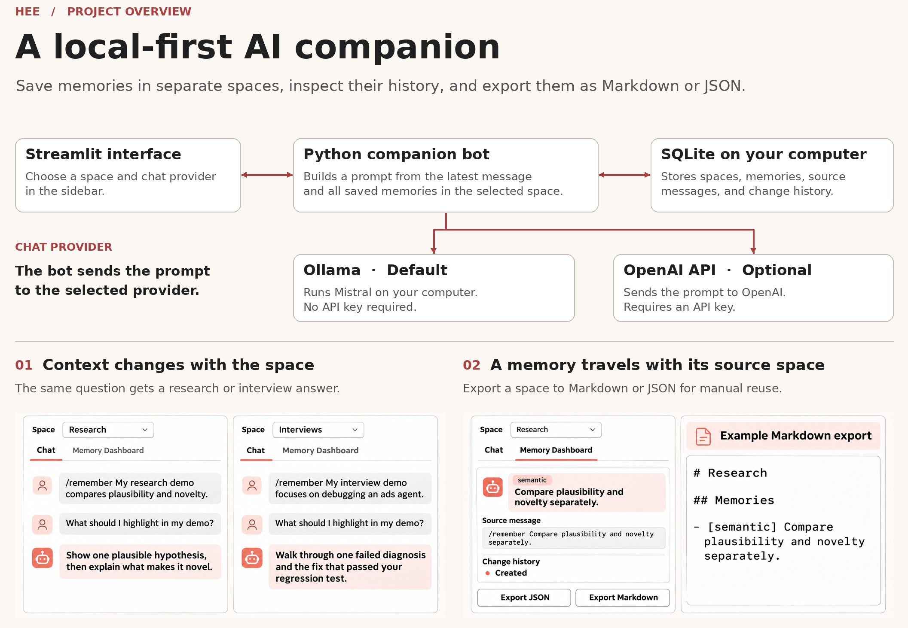

# Hee

**A local-first AI companion with memory you can inspect and export.**

Hee explores how an AI companion can carry useful context between conversations while keeping saved memories on your computer. It combines a Streamlit chat interface, local inference through Ollama, and a SQLite memory store organized into spaces.

The goal is simple: spend less time repeating your background, understand what the assistant remembers, and take that context with you.



> **Status:** Early prototype for local use. Core memory workflows have automated tests. Semantic retrieval and automatic memory consolidation are still planned.

## Features

| Capability | Current implementation |
| --- | --- |
| Local AI chat | Uses the `mistral` model through Ollama on your computer. |
| Memory spaces | Stores memories under separate spaces and uses the selected space as chat context. |
| Memory dashboard | Displays saved content, source messages, and recorded change history; includes a delete action. |
| Explicit memory commands | Save a memory with `/remember <text>` or remove active memories in the selected space with `/clear`. |
| Portable context | Exports a space's memories as JSON or Markdown for inspection or manual reuse in another tool. |
| Local persistence | Stores memory spaces, memories, and memory history in SQLite. |

## Run locally

### LLM Provider

By default, Hee uses a local Ollama instance for chat. You can also configure it to use the OpenAI API.

- **Ollama (default):** Runs locally. No API key is required.
- **OpenAI:** Uses the OpenAI API. You will need to provide an API key.

You can select the provider in the application's sidebar.

### Prerequisites

- Python 3.9 or newer.
- [Ollama](https://ollama.com/) installed and running.
- Enough memory and disk space to run the `mistral` model.

### Installation

```bash
git clone https://github.com/XU1hEEE/hee.git
cd hee
python3 -m venv .venv
source .venv/bin/activate
python -m pip install -r requirements.txt
```

On Windows, activate the environment with `.venv\Scripts\Activate.ps1` in PowerShell.

Download the model:

```bash
ollama pull mistral
```

Start Ollama through its desktop app or run `ollama serve` in a separate terminal if it is not already running. Then start Hee:

```bash
python -m streamlit run app.py
```

Open the local URL printed by Streamlit, usually `http://localhost:8501`. If that port is already in use, choose another:

```bash
python -m streamlit run app.py --server.port 8511
```

The current client defaults to `http://localhost:11434` and requests the `mistral` model. These settings live in [`hee_bot/ollama_client.py`](hee_bot/ollama_client.py). No cloud API key is required by the current application.

## How memory works

```text
Streamlit interface
        |
        v
Python companion bot
        |
        +-- SQLite: spaces, memories, sources, change history
        |
        +-- Ollama: local chat with mistral
```

For a regular chat request, the bot loads all memories in the selected space and includes their content in the model's prompt. After a successful reply, it attempts to save the user's message as an episodic memory. `/remember` attempts to save an explicit semantic memory instead.

The database records memory creation, updates, and deletion. The dashboard displays history for memories that still exist. Markdown exports contain memory content and types; JSON exports also include the metadata displayed by the dashboard.

## Storage and privacy

- The current application creates `hee_database.db` in the repository root. Its path is defined in [`hee_bot/config.py`](hee_bot/config.py).
- To use another database location, set `HEE_SQLITE_PATH` to a file path before starting the app. The parent directory must already exist. Database files and `.env` files are excluded from Git by default.
- Saved memories and their sources persist in SQLite. The visible chat transcript is held in Streamlit session state and is not persisted as a separate conversation log.
- Deleting a memory removes it from the active memory list, but its old content remains in the database's history table. `/clear` also retains deletion history.
- The app shares one database across visitors and has no login or per-user access controls. Its memory spaces separate topics, not user permissions.
- Local inference uses the configured Ollama endpoint.

## Known limitations

- **Retrieval:** Memory lookup currently returns all memories in a space. It does not rank them by relevance or use embeddings.
- **Conversation continuity:** Visible chat transcripts are separated by space within a browser session. The bot sends saved memories and the latest message to Ollama, but does not include the visible chat transcript.
- **Memory planning:** `memory_manager.py` contains logic for planning ADD, UPDATE, MERGE, KEEP, and FORGET operations, but the current chat flow does not execute those plans.
- **Backend availability:** Chat requires Ollama and `mistral`. If the model is unavailable, the app displays setup guidance; manual memory commands remain available.

## Validation

Run the automated tests from the repository root:

```bash
python -m unittest discover -s tests -v
```

The tests cover database persistence and space separation, memory commands, chat memory saving, configuration, and model error handling. Model responses are mocked, so these tests do not require Ollama or download model weights.

## Roadmap

- Add memory editing and clearer controls for retained history.
- Include recent conversation context in replies.
- Add semantic retrieval and integrate memory update and consolidation plans.
- Support document and conversation imports with source previews.
- Make exported context easier to reuse across AI assistants.

## Project structure

```text
app.py                      Streamlit chat, spaces, dashboard, and exports
hee_bot/
  bot.py                    Chat orchestration and command handling
  config.py                 SQLite database path
  database.py               Memory storage and change history
  memory_manager.py         Memory-operation planning logic
  models.py                 Memory and space data models
tests/                      Configuration, storage, bot, and client tests
requirements.txt            Runtime dependencies
pyproject.toml              Project metadata
```

## License

Copyright 2026 Hee contributors. All rights reserved; use and redistribution require prior written permission. See [LICENSE](LICENSE).
